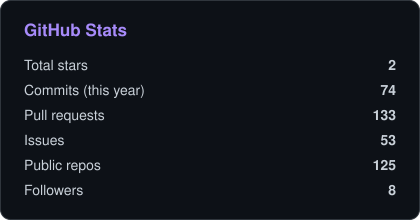
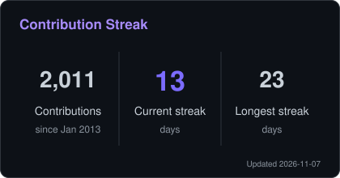
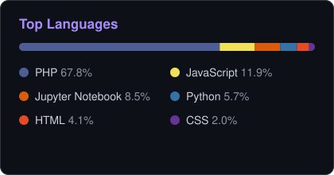

## Hi, I'm Rahul Shukla 👋

Senior Frontend Developer from Gwalior, India, with about 8 years of experience building web apps.
I work mostly with **React**, **Next.js (App Router)** and **TypeScript**, and I care about fast, accessible, maintainable UIs.

- 🌐 Portfolio: [rahulshukla.netlify.app](https://rahulshukla.netlify.app)
- ✍️ I write on [Medium](https://medium.com/@RahulShukla754)
- 💼 Let's connect on [LinkedIn](https://www.linkedin.com/in/rahulcs754/)

## Tech Stack

**Frontend**

  
  
  
  
  
  
  
  

**Backend and database**

  
  
  
  
  

**Tools**

  
  
  
  

## GitHub Stats

  
  

  

Stats are generated daily by a GitHub Action in this repo, so they never depend on a third-party image service.

## Find Me

  
  
  
  
  
  
  

